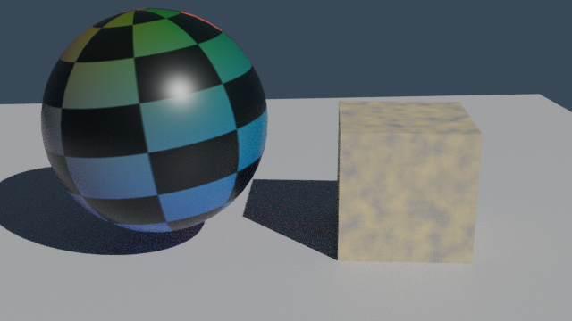
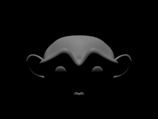
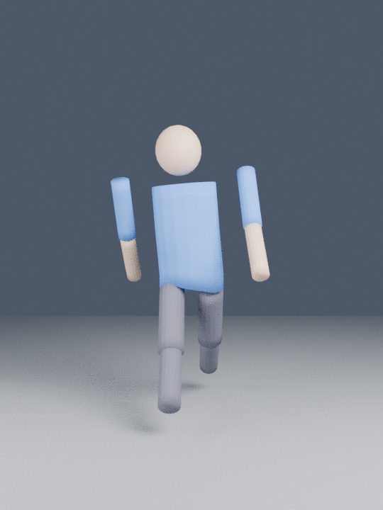
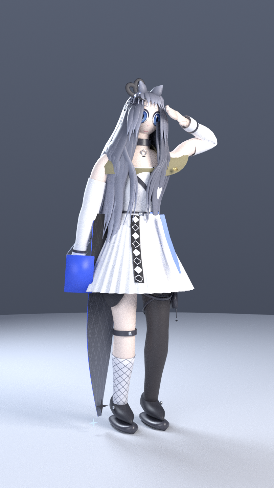
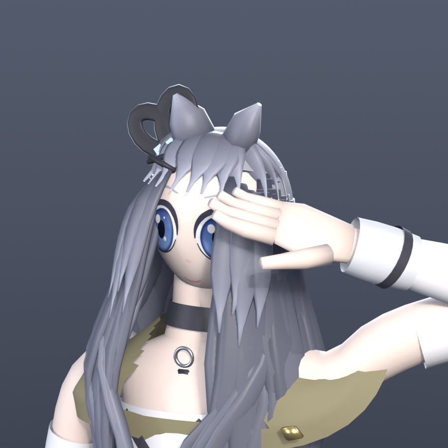
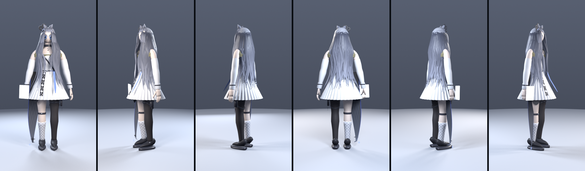
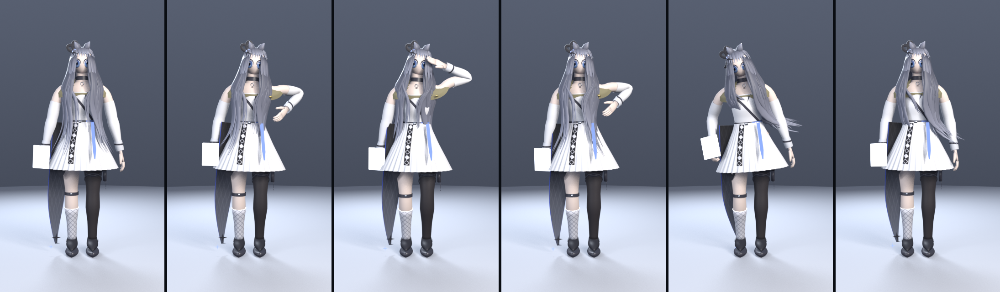
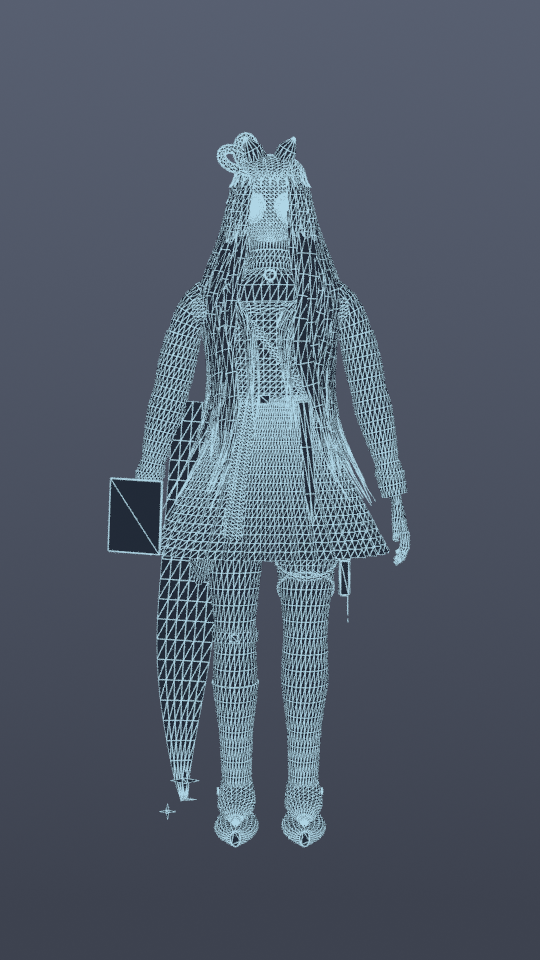
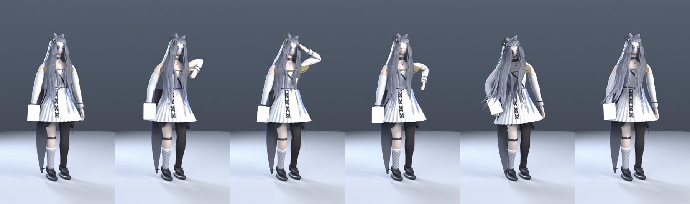

# rblender

[](https://github.com/igun997/rblender/actions/workflows/ci.yml)
[](https://github.com/igun997/rblender/releases)

**Run Blender on someone else's computer, so yours stays cool.**

Modeling, texturing, rigging, animation, rendering and export all work headless on a remote sandbox ([instabox](https://instabox.sh), [Daytona](https://daytona.io), or any Linux server you can SSH into). rblender sits on top of [rcargo](https://github.com/igun997/rcargo): rcargo supplies the machine, project sync and SSH; rblender installs Blender there on first use, runs your Python scripts, and brings the results back. You install nothing heavy locally and never open Blender.

- **Seamless.** First command provisions Blender 4.5 LTS plus its libraries on the remote (about 20 s). Later commands skip it.
- **Anything Blender can do.** Your script is plain `bpy`: sculpt/model, UV unwrap, procedural and image textures, armatures and weights, keyframes, Cycles/EEVEE renders, mp4 video, glb/fbx/obj/usd/stl/alembic/blend export.
- **Provable.** `rblender verify` decodes the outputs (PNG not blank, glb has skin and animation, mp4/fbx/usd/blend headers) instead of trusting file sizes. See [Evidence](#evidence).
- **Made for AI agents.** Ships an agent skill; the prompt below sets everything up.

## Easiest: paste this into your AI agent

Open an empty folder (or your 3D project) in Claude Code, Codex, Cursor or any agent that can run shell commands, and paste the prompt below. The agent installs rcargo and rblender, wires itself up, walks you through anything it cannot do for you (logins, keys), and proves it works by rendering real output.

````text
Set up rblender in this folder so that Blender runs on a remote machine instead of this computer. rblender is https://github.com/igun997/rblender (read its README if you need details). It is built on rcargo, https://github.com/igun997/rcargo, which provides the remote machine.

Work through these steps in order. Whenever a step needs me (a browser login, an API key, choosing a provider, installing software), stop, tell me in plain words exactly what to do and which command or link to use, and wait for me to say it is done. Never invent or guess credentials, and never ask me to paste secrets into this chat.

1. Check `rcargo --version`. If it is missing, install it:
   curl -fsSL https://raw.githubusercontent.com/igun997/rcargo/main/install.sh | sh
   Then check `rblender --version`. If it is missing, install it:
   curl -fsSL https://raw.githubusercontent.com/igun997/rblender/main/install.sh | sh
   Make sure the install folder (usually ~/.local/bin) is on PATH for this session.
2. In this folder run `rblender init`. It creates a Cargo.toml stub if the folder is not a Rust project, installs the rblender and rcargo agent skills, registers the rcargo MCP server, and writes scenes/hello.py.
3. Run `rcargo onboard --live`. If it prints SETUP REQUIRED, follow its steps: run the steps that are not marked [USER] yourself, and for [USER] steps ask me. If no remote machine is configured, ask me which I want and recommend instabox (easiest, has a free tier):
   - instabox: `npx instabox@latest` (signs in and installs its CLI), then `rcargo instances add main --backend instabox --default --description "general purpose builder"`. If I prefer an API key (no CLI needed), I create one in the instabox dashboard and set INSTABOX_API_KEY.
   - Daytona: I run `daytona login` (or set DAYTONA_API_KEY), then `rcargo instances add dt --backend daytona --set cpu=4 --set memory=8 --set disk=10 --default --description "Daytona sandbox, 4 vCPU"` (the default sandbox is only 1 vCPU / 1 GB, too small for Blender; lower the numbers if my plan's quota is smaller)
   - my own server: `rcargo instances add vps --backend ssh --set host=USER@SERVER --default --description "my build server"` (key-based ssh must already work; Debian/Ubuntu x86_64 with passwordless sudo or root)
4. Run `rblender doctor`. The first command that needs Blender installs it on the remote machine (about a minute); tell me when that happens.
5. Prove it works: run `rblender demo` and `rblender rig`, then `rblender verify out --anim`. Open the PNGs in ./out (look at them) and show me what was produced.
6. From now on never install or run Blender on this computer. Use `rblender run script.py`, `rblender eval '...'`, `rblender exec -- ...`. Read .claude/skills/rblender/SKILL.md (or .agents/skills/rblender/SKILL.md) now and follow it, including how to write scripts with the `rb` helper module.
7. Tell me in plain English what you set up, which instance is the default, that I may need to restart this agent so it loads the new skills and MCP server, and that `rblender down` pauses the remote machine to save money (it wakes up by itself on the next command).
````

Want the full character demo (a rigged, animated Vestia Zeta fan model with glb/fbx export, renders and video)? After the setup above, paste this:

````text
Using rblender in this folder (already set up), build the Vestia Zeta fan character from https://github.com/igun997/rblender: clone that repo into a sibling folder, copy its `characters/` folder into this project, then run `rblender run characters/vestia_zeta.py -- --quick` (half-resolution stills, no video, about 2 minutes). Run it without `--quick` if I want the 5 second mp4 too (about 12 minutes on a 4 vCPU box). Then run `rblender verify out --skin --anim`, open out/zeta_hero.png, out/zeta_turnaround.png, out/zeta_motion_strip.png and out/zeta_wireframe.png and describe what you see, and show me out/zeta_stats.json. Do not install Blender locally.
````

Already set up and just want another machine later? Paste this instead:

````text
Add another remote machine for rblender. Run `rcargo instances` to see what exists, ask me which provider I want (instabox, Daytona, or my own SSH server), do the steps that do not need me, and ask me for the ones that do (logins, keys). Register it with `rcargo instances add NAME --backend ... --description "what this machine is good for"`, then verify with `rblender -i NAME doctor` and tell me how to use it (`rblender -i NAME run scenes/hello.py`).
````

## Quick start

```sh
# 1. install (prebuilt binary; also install rcargo if you do not have it)
curl -fsSL https://raw.githubusercontent.com/igun997/rcargo/main/install.sh | sh
curl -fsSL https://raw.githubusercontent.com/igun997/rblender/main/install.sh | sh

# 2. in a new folder: project files, agent skills, sample script
rblender init

# 3. pick a remote machine once (see rcargo's README), then:
rblender demo                 # texture + animate + render + export
rblender run scenes/hello.py  # your own script
rblender verify out --anim
```

## Commands

```
rblender [-i INSTANCE] <command> [args]

  init                 make this folder an rblender project (Cargo.toml stub, skills, sample, rcargo init)
  setup                install Blender + helpers on the remote now (otherwise done on first use)
  doctor               check rcargo, the remote machine and Blender
  run SCRIPT.py [ARGS] run a Blender Python script from this project (bpy available)
  eval 'PYTHON'        run inline Python inside Blender
  demo [--quick]       texture, animate, render, export (glb/fbx/obj/usd/blend)
  rig  [--quick]       model + rig (armature, skin weights) + walk cycle + export glb
  exec -- BLENDER_ARGS raw blender command line (e.g. -- -b scene.blend -a)
  pull [DIR]           copy remote out/ to DIR (default ./out)
  verify [DIR] [--skin] [--anim]   prove the artifacts in DIR are real
  down                 pause the remote machine (wakes on next use)

Flags for run/eval/demo/rig: --no-pull  --keep  --xvfb  --verbose
```

Use `-i NAME` (or `RCARGO_INSTANCE`) to choose among rcargo instances. Environment: `BLENDER_VERSION` (default 4.5.16).

## Writing scripts

Scripts are normal Blender Python. `import rb` gives helpers; everything written through `rb.out("name.ext")` lands in remote `out/` and is pulled to local `./out` after the run (`out/` is wiped per run unless `--keep`). Modules in your project can be imported by sibling scripts.

```python
import bpy, rb
rb.clean()                                   # empty scene
...                                          # model, UV-unwrap, materials, armature, keyframes
rb.render_still("a.png", engine="CYCLES")    # CYCLES | EEVEE | WORKBENCH (CPU, no GPU/X needed)
rb.render_anim("a.mp4", frames=(1, 48))      # .mp4 (H.264) or PNG sequence
rb.export("model.glb", export_skins=True)    # glb gltf fbx obj usd usdc usda stl ply abc blend
rb.report()                                  # report.json with versions + file sizes
```

## Evidence

Everything below was produced by rblender on a free instabox box (Debian 13, 4 vCPU, 8 GB RAM, no GPU) driven from a laptop that never ran Blender. Blender 4.5.16 LTS. The images are in [`proof/`](proof/); CI re-creates the same artifacts on every push (see [CI](#ci)).

### 1. Zero-setup provisioning

A new machine had no Blender. The first `rblender` command ran the embedded installer (apt libraries, download, SHA-256 check, extract):

```
install-blender: downloading blender-4.5.16-linux-x64.tar.xz
blender-4.5.16-linux-x64.tar.xz: OK
Blender 4.5.16 LTS (hash 3f6797307da5 built 2026-11-10 01:31:21)
install-blender: ok -> /data/home/blender/blender
Wall time: 20.15 seconds
```

Then `rblender demo` ran in about 12-16 s end to end (sync, Blender, pull), and a tiny script (the glb re-import below) returned in about 3 s once warm.

### 2. Texturing, animation, render, export (`rblender demo`)

A generated image texture on a UV sphere, a fully procedural noise material on a UV-unwrapped cube, 24 keyframed frames, a Cycles still and an H.264 video, and five export formats.



```
$ rblender verify out --anim
[ ok ] anim.mp4 (92591 B)           MP4 container
[ ok ] scene.blend (627378 B)       Blender file (raw)
[ ok ] scene.fbx (105100 B)         binary FBX
[ ok ] scene.glb (62772 B)          glTF 2: 3 mesh, 3 material, 1 image, 4 node, 0 skin (0 joints), 2 animation
[ ok ] scene.obj (145668 B)         1118 OBJ vertices
[ ok ] scene.usdc (112528 B)        USD crate
[ ok ] still.png (357677 B)         640x360 PNG, 30590 distinct colors, mean luma 110/255
[ ok ] texture.png (4123 B)         256x256 PNG, 33489 distinct colors, mean luma 67/255
```

A user script (`scenes/hello.py`, Suzanne with subdivision) rendered with EEVEE on the same headless box, no display server:



### 3. Rigging (`rblender rig`)

A 6,538-vertex humanoid, an 11-bone armature, automatic bone-heat weights (0 unweighted vertices), a walk cycle with pose-bone keyframes, exported to glb with skin and animation.



```
$ rblender verify out --skin --anim
[ ok ] rig.glb (534464 B)           glTF 2: 2 mesh, 4 material, 0 image, 14 node, 1 skin (11 joints), 1 animation
[ ok ] rig_still.png (481245 B)     540x720 PNG, 6819 distinct colors, mean luma 127/255
[ ok ] rig_walk.mp4 (72677 B)       MP4 container
[ ok ] rig.fbx (327036 B)           binary FBX
[ ok ] rig.blend (1546305 B)        Blender file (raw)
```

### 4. Complex modeling: Vestia Zeta (fan model)

[`characters/vestia_zeta.py`](characters/vestia_zeta.py) builds a complete character from code, following her official design (silver-grey hip-length hair, twin pointed tufts, black ribbon, white pleated dress with diamond-chain panel, black strap harness and choker, olive shrug, detached sleeves, asymmetric legs with black thigh-high and holster on one side and fishnet sock with knee strap on the other, platform loafers, long lattice side cape, blue tablet). Hair is about 100 tapered clumps; the face (eyes, lashes, brows, mouth) is made of decals projected onto the skull so blinking and talking are bone-driven.

| Metric | Value |
|---|---|
| Meshes bound to the rig | 77 |
| Vertices / triangles | 33,461 / 64,056 |
| Materials / packed textures | 25 / 11 (generated procedurally, survive glTF export) |
| Bones | 123 (fingers, face swap bones, hair/skirt/cape/ribbon/tuft chains) |
| Unweighted vertices | 0 |
| Animation | 5 s at 24 fps, 121 frames, 120 animated bones, 452 F-curves |
| Python FK vs Blender's evaluated pose | 0.0 m max error on sampled bones |
| Salute: hand to target on the brow | 0.0 m (IK solved) |
| Full run on the 4 vCPU box | model 0.5 s, rig 0.6 s, animation bake 0.8 s, hero (Cycles 64 spp, 810x1440) 31 s, video (121 EEVEE frames) 727 s |

**Hero render** (Cycles, frame 54 of the salute):



**Face close-up** during the salute (hand lands on the brow, follows the head):



**Turnaround** (front, 60, 120, back, 240, 300 degrees at the idle pose):



**Animation strip** (idle, arm raise, salute hold, lowering, "pon" wobble, settle):



**Topology** (wireframe node override, 64k triangles):



**Video**: [`proof/zeta/zeta_mission_start.mp4`](proof/zeta/zeta_mission_start.mp4), H.264, 450x800, 24 fps, 121 frames (ffprobe-verified). Frames pulled from the mp4 itself:



**Verification of every artifact**:

```
$ rblender verify out --skin --anim
[ ok ] vestia_zeta.fbx (11827916 B) binary FBX
[ ok ] vestia_zeta.glb (2679816 B)  glTF 2: 77 mesh, 23 material, 6 image, 201 node, 1 skin (123 joints), 1 animation
[ ok ] zeta_face.png (926188 B)     900x900 PNG, 25595 distinct colors, mean luma 121/255
[ ok ] zeta_hero.png (1606685 B)    810x1440 PNG, 39930 distinct colors, mean luma 142/255
[ ok ] zeta_mission_start.mp4 (424439 B) MP4 container
[ ok ] zeta_motion_strip.png (1100151 B) 2190x640 PNG, 32299 distinct colors, mean luma 143/255
[ ok ] zeta_turnaround.png (1103718 B) 2190x640 PNG, 32138 distinct colors, mean luma 140/255
[ ok ] zeta_wireframe.png (627326 B) 540x960 PNG, 568 distinct colors, mean luma 92/255

10 checked, 0 failed
```

**The exported glb works in a fresh Blender**: `scenes/reimport_glb.py` imports [`proof/zeta/vestia_zeta.glb`](proof/zeta/vestia_zeta.glb) into an empty scene and evaluates the pose:

```
REIMPORT {"armatures": 1, "bones": 123, "meshes": 78, "skinned_meshes": 77,
 "action": "ZetaMissionStart", "frame_range": [1.0, 121.0],
 "hand_L_frame1": [0.29, 0.004, 0.785], "hand_L_frame54_salute": [0.208, -0.081, 1.412],
 "images": 6, "materials": 23}
```

The left hand travels from hip height (z 0.785 m) to the brow (z 1.412 m) inside the re-imported file, so rig, skin and animation survive export.

Honest limits of this model: it is built from lofted primitives and decals, so there is no sculpted detail; the face is simple, the bow reads as a heart-shaped loop, the olive shrug is thin, and EEVEE shows some shadow grain on skin. It is a demonstration of what headless scripted Blender can produce, not a production asset.

### CI

[`ci.yml`](.github/workflows/ci.yml) runs fmt, clippy (`-D warnings`) and 13 unit tests on Linux and macOS, then a **blender e2e** job that installs real Blender with the same script rblender deploys remotely, runs `py/demo.py`, `py/rig.py` and the Zeta character (`--quick`), and fails unless `rblender verify` passes (`--skin --anim`). The outputs are uploaded as a build artifact. [`release.yml`](.github/workflows/release.yml) builds binaries for Linux (x86_64, aarch64) and macOS (arm64, x86_64) on every `v*` tag and publishes the release with checksums.

First green run ([run 43640171094](https://github.com/igun997/rblender/actions/runs/43640171094)): `test (ubuntu-latest)` and `test (macos-latest)` pass, and `blender e2e` passed on a stock GitHub runner with real Blender 4.5.16: `rblender verify` reported 9/9 (demo), 7/7 (rig) and all Zeta artifacts OK, with the same stats as above (77 meshes, 64,056 triangles, 123 bones, 0 unweighted vertices, glb with 1 skin / 123 joints / 1 animation).

## How it works

1. **Transport.** rcargo picks the instance, syncs the project (changed files only) and opens one SSH session. Your code never goes through GitHub.
2. **Provision.** rblender checks a stamp (Blender version + hash of the embedded installer and helper scripts) in one probe. On mismatch it deploys the helper files and installs Blender; otherwise it skips.
3. **Run.** `blender -b --factory-startup --python-exit-code 1 -P script`, with the project and `rb` on `sys.path`. Blender's per-sample progress is filtered unless `--verbose`.
4. **Pull.** remote `out/` comes back as gzip+base64 (rcargo's shell stream is text-oriented and corrupts raw binary).
5. **Verify.** `rblender verify` decodes PNGs, parses glb JSON chunks and checks container headers.

## Limits

- Remote must be Debian/Ubuntu x86_64 with passwordless sudo or root (for the apt libraries).
- CPU rendering only (Cycles CPU, EEVEE via software GL). No GPU.
- Results travel as base64: fine for megabytes, not multi-GB render sequences.
- `rblender run` must be run from the project root.
- Your scripts and assets are uploaded to the provider you choose. Use a provider you trust.
- Only instabox was exercised end to end by the author; Daytona and plain SSH use the same rcargo backends but are untested here.

## Development

Never compile locally; use rcargo: `rcargo test`, `rcargo clippy --all-targets -- -D warnings`, `rcargo --pull build --release`.

## Credits and disclaimer

Vestia Zeta is a character of COVER Corp. / hololive Indonesia. The model in this repo is unofficial fan art generated from code for demonstration; no official assets, textures or models were used, only her public design as visual reference. Not affiliated with or endorsed by COVER Corp.

MIT licensed.
